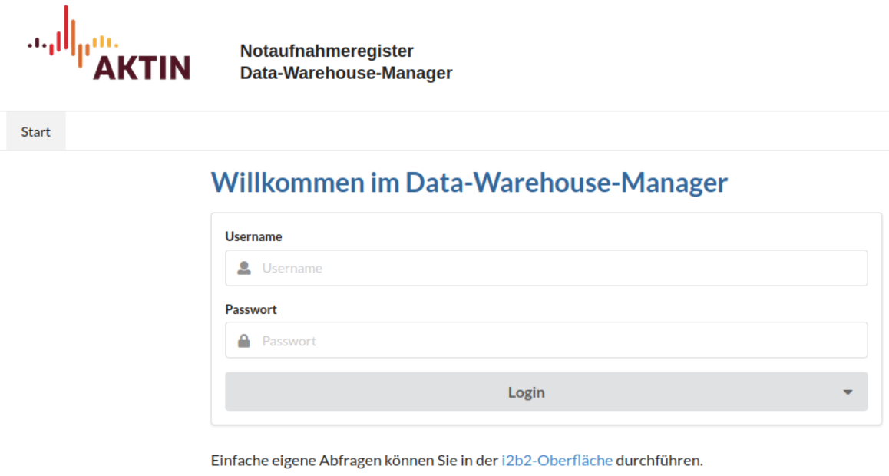
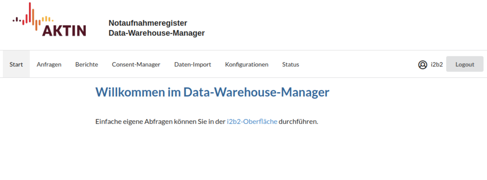

# Nutzerverwaltung

Der Data Warehouse Manager (DWH-Manager) ist die zentrale Anwendung zur Steuerung des AKTIN DWH. Hier verwalten Sie eingehende Datenanfragen und generieren Monatsberichte.

## Anmeldung

1. Rufen Sie den DWH-Manager in Ihrem Browser auf: `http://<SERVER-IP>/aktin/admin`. Ersetzen Sie `<SERVER-IP>` durch die IP-Adresse Ihres Servers.

2. Melden Sie sich mit Ihren Zugangsdaten an. Dazu werden die Benutzerdaten Ihrer [i2b2-Instanz][i2b2-operation] verwendet. Nach dem Login haben Sie Zugriff auf die Verwaltung der einzelnen
   Funktionalitäten.

