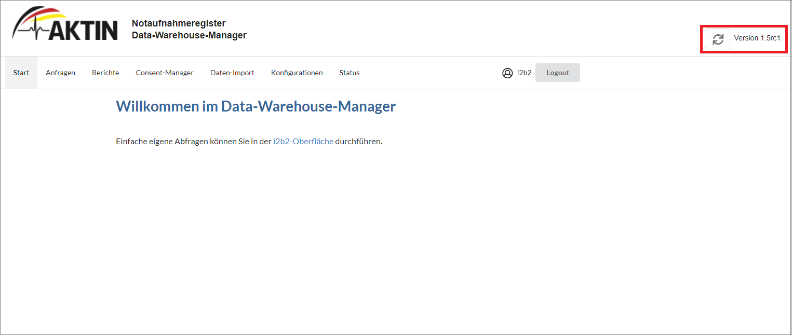
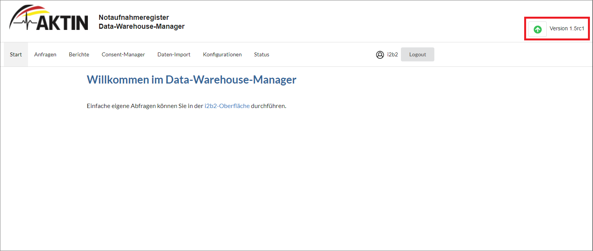
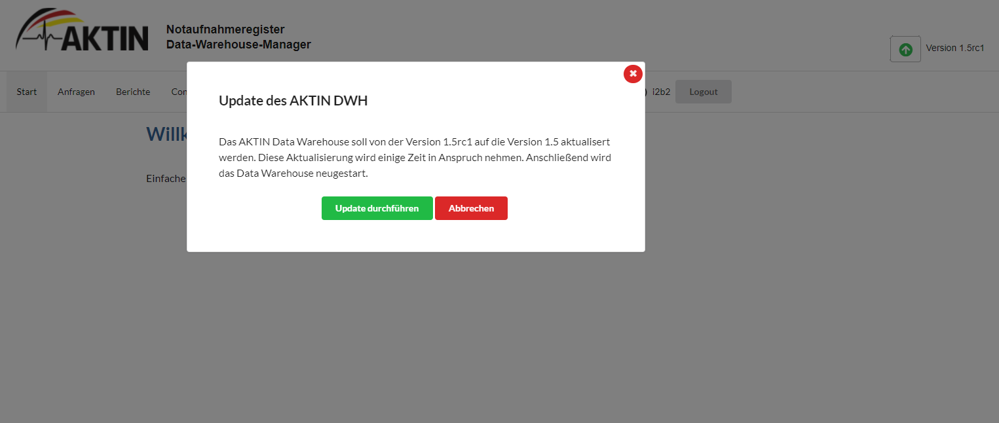
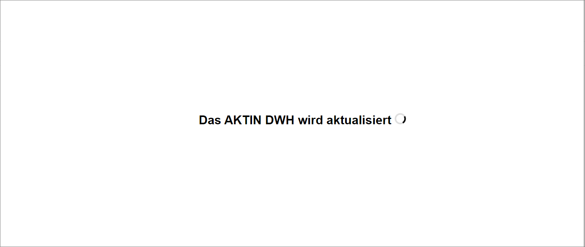
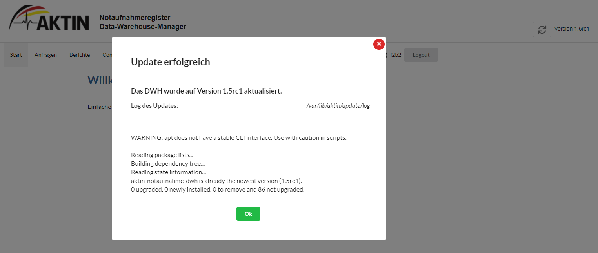

# Debian-Aktualisierung

Seit Version 1.5 des AKTIN Data Warehouse (kurz DWH) wurde der Aktualisierungsprozess durch die Debian-Paketierung deutlich vereinfacht. Anstelle eines separaten Skripts übernimmt nun der Debian-Paketmanager die Aktualisierung
automatisch im Hintergrund.

Sie können die Aktualisierung über die Kommandozeile (CLI) oder den DWH-Manager starten. Das DWH wird während des Vorgangs neu gestartet. Falls die Aktualisierung fehlschlägt, stellt das System
automatisch die vorherige Version wieder her. In diesem Fall wenden Sie sich bitte an den [AKTIN IT-Support][support-email].

::: warning
Diese Anleitung gilt nur für Aktualisierungen ab Version 1.5. Für eine Aktualisierung von Version 1.4 oder älter wenden Sie sich an den [AKTIN IT-Support][support-email].
:::

## 1. Aktualisierung über die Kommandozeile

Für die Aktualisierung werden administrative Rechte benötigt. Öffnen Sie eine `root`-Sitzung:

```bash
sudo -i
```

Prüfen Sie Ihr installiertes Betriebssystem über den Befehl:

```bash
lsb_release -a
```

Die Ausgabe sollte Ubuntu {{ $theme.versions.ubuntu }} LTS (Codename {{ $theme.versions.codename }}) enthalten.

Für die Aktualisierung auf die aktuelle Version {{ $theme.versions.dwh }} wird das AKTIN-Repository "{{ $theme.versions.codename }}" benötigt. Falls es nicht vorhanden ist, folgen Sie den Hinweisen im
Abschnitt [AKTIN Repository einbinden][repo-aktin] der Installationsanleitung, um es hinzuzufügen.

Anschließend können Sie über folgende Befehle die Paketlisten des Paketmanagers neu einlesen und die neuesten verfügbaren Pakete des DWH installieren:

```bash
apt update
apt install --only-upgrade aktin-notaufnahme-i2b2
apt install --only-upgrade aktin-notaufnahme-dwh
apt install --only-upgrade aktin-notaufnahme-updateagent
```

Mit diesen Befehlen werden die drei zentralen Pakete des DWH auf die jeweils aktuelle Version aktualisiert. Das Flag `--only-upgrade` sorgt dafür, dass keine neuen Pakete installiert,
sondern nur bestehende aktualisiert werden. Weitere Schritte sind nicht erforderlich. Während der Aktualisierung steht das DWH nicht zur Verfügung. Wenn bereits die aktuelle Version installiert
ist, zeigt die Konsole einen entsprechenden Hinweis. Nach Abschluss der Aktualisierung kann das DWH wieder normal verwendet werden.

## 2. Aktualisierung über den DWH-Manager

Um das DWH über den DWH-Manager zu aktualisieren, öffnen Sie diesen zunächst in Ihrem Browser.

### 2.1 Suche nach einer neuen Version

Klicken Sie oben rechts auf den Aktualisierungs-Button. Während der Suche zeigt der Button eine laufende Animation. Wenn die Animation endet, ohne dass sich der Button ändert, ist bereits die aktuelle Version
installiert.



### 2.2 Initialisierung der Aktualisierung

Wenn eine neue Version gefunden wurde, ändert sich der Button. Klicken Sie ihn an, um die Aktualisierung zu starten. Ein Hinweisfenster informiert Sie darüber, dass das DWH während der Aktualisierung
nicht verfügbar ist und nach Abschluss automatisch neu gestartet wird. Bestätigen Sie den Hinweis mit **Update durchführen**, um den Vorgang zu beginnen.





### 2.3 Durchführung der Aktualisierung

Während der Aktualisierung werden Sie auf eine externe Statusseite weitergeleitet. Dort sehen Sie den Fortschritt des Prozesses. Nach Abschluss werden Sie automatisch auf die Startseite des DWH
zurückgeleitet.



### 2.4 Abschluss der Aktualisierung

Nach der Aktualisierung erscheint ein Hinweisfenster mit dem Ergebnis und der Konsolenausgabe. Schließen Sie dieses Fenster, um wieder in den Normalbetrieb zu wechseln. Das Fenster kann jederzeit erneut
geöffnet werden, indem Sie auf die Versionsnummer oben rechts klicken.


